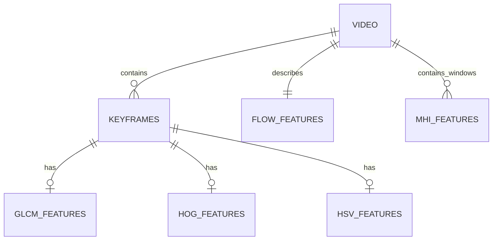

# 3. Trích rút đặc trưng, quản trị dữ liệu và tìm kiếm video tương đồng

## 3.1. Mục tiêu và quy trình tổng quát

Ở mục này, hệ thống sử dụng các thư viện xử lý ảnh và video để trích rút đặc trưng cho từng video, lưu kết quả cùng thông tin mô tả vào PostgreSQL, sau đó khai thác các đặc trưng để xếp hạng những video gần với video truy vấn.

Quy trình xử lý tổng quát gồm:

1. Đọc video và thu thập thông tin như tên tệp, đường dẫn, nhãn hành động, FPS, số frame, thời lượng và kích thước frame.
2. Lấy mẫu frame hoặc cửa sổ thời gian theo cấu hình của từng thuật toán.
3. Tính các vector đặc trưng HOG, HSV, GLCM, Optical Flow và MHI.
4. Gắn kết quả với `video_id` hoặc `keyframe_id`, lưu tạm dưới dạng CSV đã xử lý.
5. Nạp metadata và vector đặc trưng vào các bảng PostgreSQL.
6. Khi có video truy vấn, trích rút đặc trưng theo cùng cấu hình, lọc tập ứng viên theo metadata nếu cần, tính điểm tương đồng và trả về danh sách xếp hạng.

Trong mã nguồn, bước trích rút và nạp CSV đã có chương trình chạy được. Phần xếp hạng tương đồng hiện mới được cài đặt cho HSV và GLCM; HOG, Flow và MHI chưa có hàm tính tương đồng hoàn chỉnh. Vì vậy, cơ chế kết hợp nhiều đặc trưng ở mục 3.4.3 được trình bày như thiết kế đề xuất, không phải kết quả đã được triển khai đầy đủ.

## 3.2. Các đặc trưng được trích rút

Hệ thống dùng OpenCV để đọc và tiền xử lý frame, NumPy để biểu diễn vector, scikit-image để tính HOG. Mỗi đặc trưng mô tả một khía cạnh khác nhau của video.

| Đặc trưng | Cách tính trong hệ thống | Đầu ra lưu trữ |
|---|---|---|
| Metadata | Đọc thuộc tính tệp/video: tên, đường dẫn, lớp hành động, FPS, số frame, thời lượng, chiều rộng và chiều cao. | Một bản ghi cho mỗi video. |
| HOG | Lấy một frame mỗi giây; resize về 128 × 128, chuyển sang ảnh xám; dùng 9 hướng gradient, cell 8 × 8, block 2 × 2 và chuẩn hóa L2-Hys. | Một vector 8.100 chiều cho mỗi keyframe. |
| HSV histogram | Lấy một frame xấp xỉ mỗi giây; chuyển BGR sang HSV; lượng tử hóa 8 bin Hue, 3 bin Saturation và 3 bin Value. Histogram được chuẩn hóa theo tổng số pixel. | Histogram 72 chiều cho mỗi keyframe. |
| GLCM | Chuyển frame sang xám, lượng tử hóa thành 8 mức xám; lập ma trận đồng xuất hiện ở bốn hướng; tính Energy, Contrast, Entropy và Homogeneity rồi lấy trung bình theo hướng. | Vector 4 chiều cho mỗi keyframe. |
| Farnebäck Optical Flow | Lấy mẫu khoảng 5 FPS, resize 320 × 240, chuyển xám; tính chuyển động giữa các frame liên tiếp. Vector gồm histogram hướng chuyển động 8 bin và 5 thống kê về độ lớn/hướng chuyển động. | Vector 13 chiều cho mỗi video. |
| MHI | Lấy mẫu khoảng 5 FPS, resize 320 × 240, chia các frame thành cửa sổ khoảng một giây; tính Motion History Image từ sai khác frame với ngưỡng chuyển động 25, resize về 16 × 16. | Vector 256 chiều cho mỗi cửa sổ. |

HOG, HSV và GLCM tạo đặc trưng theo keyframe nên số vector phụ thuộc thời lượng video. Flow tạo một vector tổng hợp cho cả video. MHI tạo một vector cho mỗi cửa sổ thời gian. Việc giữ mốc thời gian và chỉ số frame giúp truy ngược đặc trưng về vị trí trong video.

## 3.3. Tổ chức dữ liệu và cơ sở dữ liệu PostgreSQL

Dữ liệu sau tiền xử lý được tổ chức thành bảy CSV tương ứng với bảy nhóm bảng. Trường `vector` chứa danh sách số; uploader chuyển danh sách này thành kiểu PostgreSQL `JSONB` khi nạp.

| CSV | Bảng PostgreSQL | Khóa liên kết chính |
|---|---|---|
| `metadata.csv` | `video` | `video_id` |
| `keyframes.csv` | `keyframes` | `keyframe_id`, tham chiếu logic đến `video_id` |
| `flow_features.csv` | `flow_features` | `video_id` |
| `glcm_features.csv` | `glcm_features` | `keyframe_id` |
| `hog_features.csv` | `hog_features` | `keyframe_id` |
| `hsv_features.csv` | `hsv_features` | `keyframe_id` |
| `mhi_features.csv` | `mhi_features` | `video_id` và `mhi_window_index` |

Quan hệ logic giữa các bảng:



Bảng `video` lưu metadata cấp video. Bảng `keyframes` lưu danh sách frame mẫu và thời điểm tương ứng. Các bảng HOG, GLCM, HSV tham chiếu keyframe; Flow tham chiếu video; MHI tham chiếu video và số thứ tự cửa sổ.

Chương trình nạp dữ liệu hiện có trong `src/d23_lop4_nhom16/run_upload.py` và `src/d23_lop4_nhom16/uploader.py`. Chương trình đọc các CSV trong `src/d23_lop4_nhom16/processed_features/`, chuẩn hóa tên cột có khoảng trắng, chuyển `vector` thành JSON và nạp theo thứ tự metadata, keyframe rồi đến feature. Mặc định `if_exists=fail` để tránh ghi đè bảng có sẵn; có thể chọn `append` khi chủ động bổ sung dữ liệu.

Lưu ý về thiết kế hiện tại: `pandas.to_sql` tạo bảng và kiểu cột nhưng chưa khai báo `PRIMARY KEY`, `FOREIGN KEY`, `UNIQUE` hoặc chỉ mục. Các cột ID hiện được dùng như khóa liên kết ở mức ứng dụng, chưa được PostgreSQL cưỡng chế toàn vẹn tham chiếu. Khi triển khai chính thức nên tạo schema bằng DDL/migration trước, rồi nạp dữ liệu vào các bảng đã định nghĩa.

Ví dụ DDL rút gọn cho các bảng quan hệ:

```sql
CREATE TABLE video (
    video_id BIGINT PRIMARY KEY,
    filename TEXT NOT NULL,
    filepath TEXT NOT NULL UNIQUE,
    category TEXT,
    fps DOUBLE PRECISION,
    total_frames INTEGER,
    duration DOUBLE PRECISION,
    width INTEGER,
    height INTEGER
);

CREATE TABLE keyframes (
    keyframe_id BIGINT PRIMARY KEY,
    video_id BIGINT NOT NULL REFERENCES video(video_id),
    frame_idx INTEGER NOT NULL,
    timestamp_sec DOUBLE PRECISION NOT NULL,
    keyframe_index INTEGER
);

CREATE TABLE flow_features (
    video_id BIGINT PRIMARY KEY REFERENCES video(video_id),
    filepath TEXT,
    vector JSONB NOT NULL
);

CREATE TABLE glcm_features (
    keyframe_id BIGINT PRIMARY KEY REFERENCES keyframes(keyframe_id),
    vector JSONB NOT NULL
);

CREATE TABLE hog_features (
    keyframe_id BIGINT PRIMARY KEY REFERENCES keyframes(keyframe_id),
    vector JSONB NOT NULL
);

CREATE TABLE hsv_features (
    keyframe_id BIGINT PRIMARY KEY REFERENCES keyframes(keyframe_id),
    vector JSONB NOT NULL
);

CREATE TABLE mhi_features (
    video_id BIGINT NOT NULL REFERENCES video(video_id),
    mhi_window_index INTEGER NOT NULL,
    filepath TEXT,
    vector JSONB NOT NULL,
    PRIMARY KEY (video_id, mhi_window_index)
);
```

DDL trên là thiết kế tham khảo. Trước khi áp dụng cần kiểm tra lại dữ liệu thực tế, đặc biệt số lượng vector HOG và các keyframe tương ứng: trong bộ CSV hiện tại số dòng giữa các bảng đặc trưng theo keyframe không hoàn toàn bằng nhau. Nếu thiếu vector ở một số keyframe thì không được giả định rằng mỗi keyframe đều có đủ cả ba loại feature.

## 3.4. Cơ chế tìm kiếm video tương đồng

### 3.4.1. Tiền lọc bằng metadata

Metadata được dùng để giới hạn tập ứng viên trước khi so sánh vector. Ví dụ, nếu người dùng tìm video tương tự trong cùng loại hành động, chỉ lấy video có cùng `category`; có thể giới hạn thêm theo thời lượng hoặc độ phân giải. Bước lọc này giảm số phép so sánh, đồng thời giúp kết quả phù hợp với mục đích truy vấn.

Ví dụ truy vấn danh sách ứng viên:

```sql
SELECT video_id, filename, filepath, category, duration
FROM video
WHERE category = :category
  AND duration BETWEEN :min_duration AND :max_duration;
```

Các điều kiện metadata là bộ lọc ứng viên, không thay thế phép so sánh đặc trưng hình ảnh/chuyển động.

### 3.4.2. So sánh từng loại đặc trưng

**HSV.** Histogram giao nhau được tính bằng tổng giá trị nhỏ hơn tại từng bin:

$$
S_{HSV}(q,c)=\sum_i \min(q_i,c_i)
$$

Với video có nhiều keyframe, hàm hiện có lấy điểm cao nhất của mỗi keyframe truy vấn so với các keyframe ứng viên, rồi trung bình các điểm cao nhất đó. Vì histogram đã chuẩn hóa, điểm càng lớn thể hiện phân bố màu càng gần.

**GLCM.** Các vector được chuẩn hóa bằng `StandardScaler`; sau đó tính khoảng cách Euclid giữa các vector. Với mỗi vector của video truy vấn, chọn vector gần nhất trong tập ứng viên và chuyển khoảng cách thành điểm tương đồng:

$$
S_{GLCM}=\frac{1}{N}\sum_{i=1}^{N}\frac{1}{1+d_i}
$$

Trong đó $d_i$ là khoảng cách nhỏ nhất của vector truy vấn thứ $i$ tới các vector ứng viên sau chuẩn hóa. Hàm này yêu cầu scaler đã được fit trên dữ liệu tham chiếu và đang được cài trong `similarity/glcm_similarity.py`.

### 3.4.3. Kết hợp nhiều đặc trưng (đề xuất)

Để xếp hạng tổng thể, có thể chuẩn hóa điểm của từng bộ mô tả về cùng miền, sau đó tính tổng có trọng số:

$$
S(q,c)=w_{HSV}S_{HSV}+w_{GLCM}S_{GLCM}+w_{HOG}S_{HOG}+w_{Flow}S_{Flow}+w_{MHI}S_{MHI}
$$

Trong đó $w_j \ge 0$ và tổng các trọng số bằng 1. Trọng số có thể được xác định bằng thực nghiệm trên tập validation; không nên khẳng định bộ trọng số tối ưu nếu chưa đánh giá. Khi một bộ đặc trưng không có dữ liệu cho video, cần bỏ thành phần đó và chuẩn hóa lại tổng trọng số trên các đặc trưng còn lại.

Đối với các đặc trưng theo thời gian, có thể tính độ tương đồng giữa các vector keyframe/cửa sổ bằng nearest-neighbor như GLCM, sau đó lấy trung bình hoặc trung bình có trọng số. Với Flow, mỗi video có một vector 13 chiều nên có thể áp dụng cosine similarity hoặc khoảng cách Euclid sau chuẩn hóa. Với HOG, có thể áp dụng khoảng cách cosine/Euclid cho từng keyframe và tổng hợp điểm theo video. Với MHI, có thể so sánh các cửa sổ chuyển động theo cách tương tự. Đây là các lựa chọn cần triển khai và kiểm nghiệm; các module `hog_similarity.py`, `flow_similarity.py`, `mhi_similarity.py` hiện chưa có nội dung.

Quy trình truy vấn đầy đủ được đề xuất:

1. Người dùng cung cấp video truy vấn và điều kiện metadata tùy chọn.
2. Hệ thống trích rút đúng các đặc trưng và cấu hình giống dữ liệu tham chiếu.
3. PostgreSQL lọc ứng viên theo `category`, thời lượng hoặc điều kiện khác.
4. Nạp các vector của ứng viên, tính điểm riêng theo từng bộ mô tả.
5. Kết hợp điểm theo trọng số, sắp xếp giảm dần và trả về top-$k$ video cùng metadata và đường dẫn.

Với quy mô dữ liệu hiện tại, có thể truy xuất JSONB theo các ID rồi tính khoảng cách bằng NumPy/scikit-learn trong tầng ứng dụng. JSONB phù hợp để lưu trữ linh hoạt nhưng không tự cung cấp phép tìm nearest-neighbor vector hiệu quả; nếu số lượng dữ liệu tăng lớn, nên cân nhắc lưu vector dạng mảng số hoặc dùng PostgreSQL với extension vector và chỉ mục phù hợp.

## 3.5. Tình trạng dữ liệu và giới hạn

Tại thời điểm kiểm tra bộ CSV, số dòng lần lượt là: 501 video, 6.350 keyframe, 501 vector Flow, 5.869 vector GLCM, 5.849 vector HOG, 5.869 vector HSV và 5.739 cửa sổ MHI. HOG có 8.100 chiều; HSV 72; GLCM 4; Flow 13; MHI 256. Đây là thống kê của bộ CSV hiện có và có thể thay đổi khi chạy lại tiền xử lý.

Các giới hạn cần nêu trong báo cáo:

- Số lượng GLCM, HOG và HSV không bằng nhau; cần đối chiếu `keyframe_id` trước khi kết hợp kết quả theo frame.
- Việc lưu file CSV chưa chứng minh mọi video đều trích xuất thành công; cần kiểm tra khóa ngoại/độ phủ ID khi nạp.
- Uploader tạo bảng tự động và chưa tạo ràng buộc khóa chính/khóa ngoại; DDL tham khảo ở trên cần được áp dụng nếu yêu cầu toàn vẹn quan hệ ở mức database.
- Mới có thuật toán tìm tương đồng cho HSV và GLCM. Cần hoàn thiện HOG, Flow, MHI và phép kết hợp trọng số trước khi mô tả hệ thống là tìm kiếm đa đặc trưng hoàn chỉnh.
- Cần đánh giá chất lượng bằng các chỉ số như Precision@k, Recall@k hoặc nDCG trên truy vấn có nhãn liên quan; chưa có số đo thì chỉ nên trình bày đây là cơ chế thiết kế.

## 3.6. Kết luận

Hệ thống hiện có pipeline trích rút năm nhóm đặc trưng hình ảnh/chuyển động và metadata, biểu diễn kết quả thành các bảng CSV có quan hệ qua ID, đồng thời có uploader để đưa dữ liệu vào PostgreSQL. Metadata hỗ trợ lọc tập ứng viên; HSV và GLCM đã có hàm so sánh vector. Để hoàn thiện chức năng tìm kiếm video tương đồng, bước tiếp theo là thiết lập schema có ràng buộc, kiểm tra tính đầy đủ của các ID, triển khai so sánh HOG/Flow/MHI, xác định cách kết hợp điểm và đánh giá top-$k$ trên tập kiểm thử.
